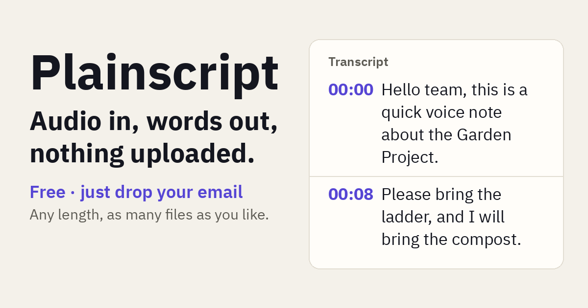

# Plainscript

Plainscript turns a recording into a timestamped transcript — right in your browser. OpenAI Whisper runs on your own device via transformers.js, so the audio is never uploaded. Live app: https://thatched-tools.pages.dev/go/plainscript/readme

**Audio in, words out — nothing uploaded.**

## What it does
- Drop in an MP3, M4A or WAV.
- Get a timestamped transcript in the page, line by line.
- Copy the text, or export TXT or SRT subtitles.

## How it works
- Whisper runs in your browser through transformers.js in a web worker.
- The model downloads once (the browser caches it); after that it works offline.
- The audio never leaves your device — nothing is uploaded to a server.

## Price
Free — just add your email to unlock the tool. No payment and no subscription.

Works on phone or computer. Made by THATCHED.
